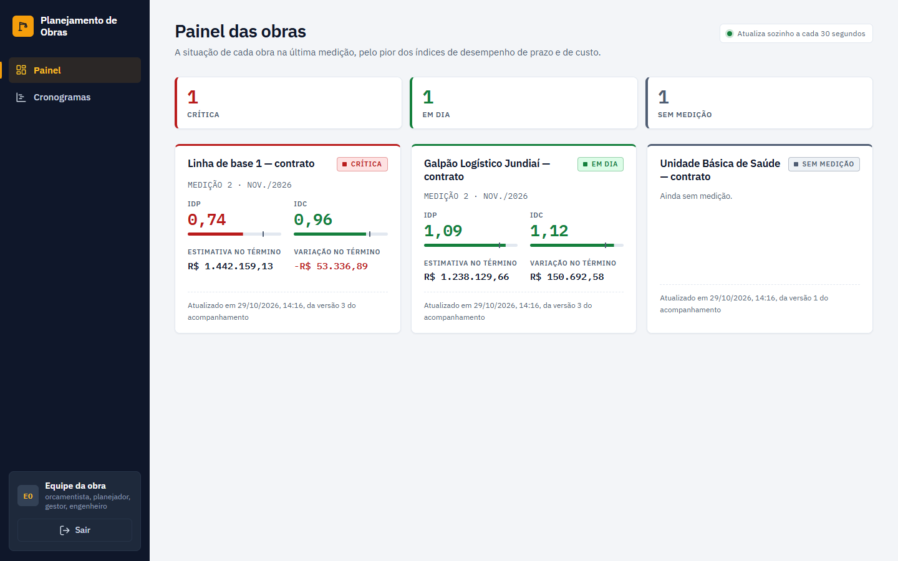
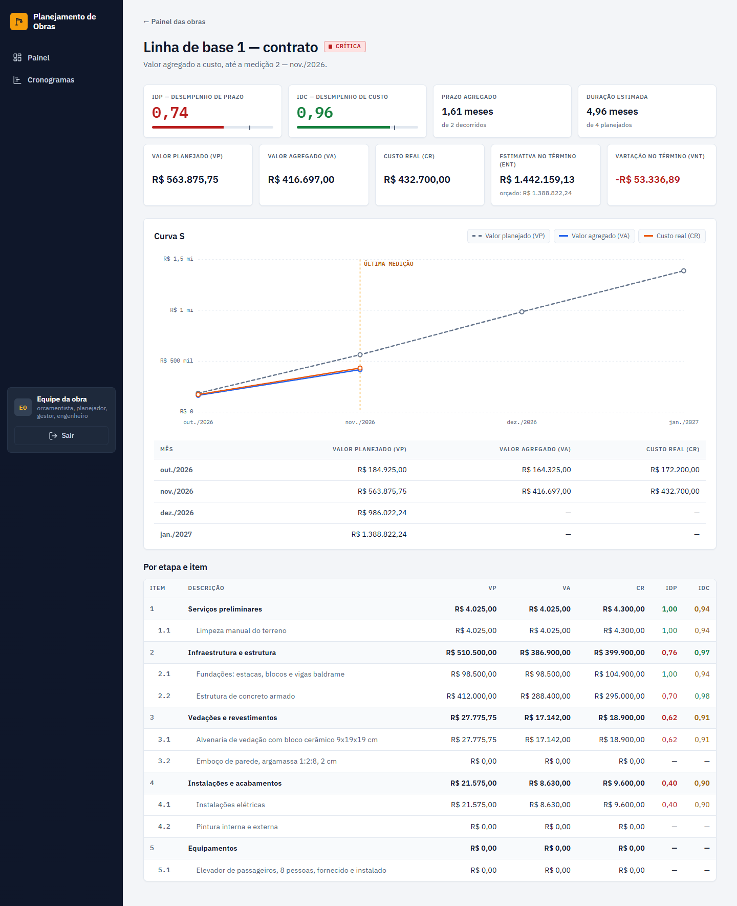
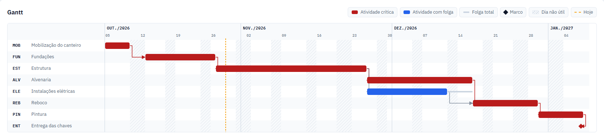

# Planejamento e Controle de Obras

[](https://github.com/MarcusBomfim/planejamento-obras/actions/workflows/ci.yml)
[](https://github.com/MarcusBomfim/planejamento-obras/actions/workflows/e2e.yml)
[](https://github.com/MarcusBomfim/planejamento-obras/actions/workflows/entrega.yml)
[](LICENSE)

Planejamento e controle de obra como o engenheiro de planejamento faz: rede de precedências e caminho crítico, orçamento com composições de custo e BDI, o cronograma físico-financeiro que junta os dois — e a obra medida mês a mês contra o plano aprovado, com boletim de medição, valor agregado e um painel das obras que se atualiza em segundo plano a cada medição. Pela API ou no navegador, com o Gantt e a curva S; em contêineres, com o rastro de cada medição do pedido HTTP ao painel.

C# 14 · .NET 10 · ASP.NET Core 10 · EF Core 10 · PostgreSQL 17 · React 19 · TypeScript · Vite · TanStack Query · OpenTelemetry · Docker · Testcontainers · xUnit v3 · Vitest · Playwright · GitHub Actions

## O problema

Obra atrasa por causa de poucas atividades — as que seguram a data de entrega. O problema é saber quais são. Uma alvenaria que atrasa três dias pode não mudar nada; uma estrutura que atrasa um dia atrasa a entrega em um dia.

O método do caminho crítico responde três perguntas:

- **quais atividades não podem atrasar** — as críticas;
- **quanto cada uma das outras pode escorregar** — a folga, total e livre;
- **quando cada uma começa e termina** — no calendário real, com fim de semana e feriado.

O orçamento responde **quanto** a obra custa. Junto com o cronograma, responde a pergunta que o cliente e o banco fazem: **quanto se gasta em cada mês** — o cronograma físico-financeiro.

Aprovado, o plano vira régua: a **linha de base**. Todo mês a obra é medida contra ela. O boletim de medição diz quanto se paga; o **valor agregado** diz se a obra está atrasada, se está gastando mais que o orçado e onde vai terminar.

Este projeto é a continuação do [gestao-obras](https://github.com/MarcusBomfim/gestao-obras), que registra o que aconteceu no canteiro e cita, entre as suas limitações, a falta de um cronograma de verdade. Aqui se planeja o que vai acontecer.

## Exemplo

O exemplo inteiro — rede, base de custos, orçamento, físico-financeiro, medições e valor agregado — está em [`ExemploDoReadmeTests`](tests/PlanejamentoObras.Dominio.Testes/ExemploDoReadmeTests.cs). É um teste: se o código mudar e algum número desta página deixar de ser verdade, o build quebra.

### Cronograma

```csharp
var cronograma = new Cronograma("Residencial Vista Serra");

cronograma.AdicionarAtividade("MOB", "Mobilização do canteiro", 5);
cronograma.AdicionarAtividade("FUN", "Fundações", 10);
cronograma.AdicionarAtividade("EST", "Estrutura", 20);
cronograma.AdicionarAtividade("ALV", "Alvenaria", 15);
cronograma.AdicionarAtividade("ELE", "Instalações elétricas", 12);
cronograma.AdicionarAtividade("REB", "Reboco", 8);
cronograma.AdicionarAtividade("PIN", "Pintura", 6);
cronograma.AdicionarAtividade("ENT", "Entrega das chaves", 0);

cronograma.AdicionarDependencia("MOB", "FUN");
cronograma.AdicionarDependencia("FUN", "EST");
cronograma.AdicionarDependencia("EST", "ALV");
cronograma.AdicionarDependencia("EST", "ELE");
cronograma.AdicionarDependencia("ALV", "REB");
cronograma.AdicionarDependencia("ELE", "REB");
cronograma.AdicionarDependencia("REB", "PIN");
cronograma.AdicionarDependencia("PIN", "ENT");

var calendario = CalendarioDeTrabalho.DeSegundaASexta(
[
    new DateOnly(2026, 10, 12), new DateOnly(2026, 11, 2),
    new DateOnly(2026, 11, 20), new DateOnly(2026, 12, 25),
    new DateOnly(2027, 1, 1),
]);

var obra = ProgramacaoDoCronograma.Programar(cronograma, new DateOnly(2026, 10, 5), calendario);
```

Resultado: de 05/10/2026 a 07/01/2027, 64 dias úteis. Em negrito, o caminho crítico.

| | Atividade | Dias | Início | Término | Folga |
|---|---|--:|---|---|--:|
| **MOB** | Mobilização do canteiro | 5 | seg. 05/10 | sex. 09/10 | — |
| **FUN** | Fundações | 10 | ter. 13/10 | seg. 26/10 | — |
| **EST** | Estrutura | 20 | ter. 27/10 | qua. 25/11 | — |
| **ALV** | Alvenaria | 15 | qui. 26/11 | qua. 16/12 | — |
| ELE | Instalações elétricas | 12 | qui. 26/11 | sex. 11/12 | 3 (até qua. 16/12) |
| **REB** | Reboco | 8 | qui. 17/12 | ter. 29/12 | — |
| **PIN** | Pintura | 6 | qua. 30/12 | qui. 07/01 | — |
| **ENT** | Entrega das chaves | 0 | qui. 07/01 | qui. 07/01 | — |

As fundações começam na terça porque a segunda, 12/10, é feriado. A elétrica pode atrasar três dias úteis sem mexer na entrega; a alvenaria, nenhum. E a entrega das chaves aparece no último dia da pintura, não no dia seguinte — o porquê está na [ADR-0003](docs/adr/0003-tempo-em-dias-uteis-e-intervalos-semiabertos.md).

### Orçamento

Os preços vêm de uma base de custos: insumos com preço e composições que dizem quanto de cada insumo entra numa unidade de serviço. Uma composição pode usar outra — a argamassa entra na alvenaria e no reboco.

```csharp
var baseDeCustos = new BaseDeCustos("Tabela própria — setembro de 2026", new DateOnly(2026, 9, 1));

baseDeCustos.AdicionarInsumo("BLO", "Bloco cerâmico de vedação 9x19x19 cm", "un", TipoDeInsumo.Material, 1.32m);
baseDeCustos.AdicionarInsumo("PED", "Pedreiro, com encargos sociais", "h", TipoDeInsumo.MaoDeObra, 28.74m);
// … cimento, cal, areia, servente, betoneira

baseDeCustos.AdicionarComposicao("ALV", "Alvenaria de vedação com bloco cerâmico 9x19x19 cm", "m²");
baseDeCustos.AdicionarItem("ALV", "BLO", 13.5m);
baseDeCustos.AdicionarItem("ALV", "ARG", 0.012m); // a argamassa é outra composição
baseDeCustos.AdicionarItem("ALV", "PED", 0.80m);
baseDeCustos.AdicionarItem("ALV", "SER", 0.40m);

var bdi = Bdi.PelaFormulaDoTcu(new ParcelasDoBdi(
    administracaoCentral: 4.00m, seguros: 0.40m, riscos: 1.27m, garantias: 0.40m,
    despesasFinanceiras: 1.23m, lucro: 7.40m, tributos: 6.15m)); // 22,88 %

var orcamento = new Orcamento("Residencial Vista Serra", bdi);
orcamento.AdicionarEtapa("Vedações e revestimentos");      // 3
orcamento.AdicionarItem("3", "ALV", 2430.50m);             // 3.1
orcamento.VincularAtividade("3.1", "ALV");                 // a atividade do cronograma
// … as outras etapas e itens

var planilha = CalculadoraDoOrcamento.Calcular(orcamento, baseDeCustos);
```

A composição da alvenaria, aberta — a argamassa entra pelo custo dela, R$ 646,06 o m³:

| Item | Coeficiente | Custo unitário | Custo parcial |
|---|--:|--:|--:|
| Bloco cerâmico 9x19x19 cm (un) | 13,5 | 1,32 | 17,82 |
| Argamassa 1:2:8 (m³) | 0,012 | 646,06 | 7,75 |
| Pedreiro (h) | 0,80 | 28,74 | 22,99 |
| Servente (h) | 0,40 | 21,46 | 8,58 |
| **Alvenaria (m²)** | | | **57,14** |

E a planilha, com BDI de 22,88 % e, no elevador, BDI diferenciado de 12 %:

| | Descrição | Un | Quantidade | Custo un. | Preço un. | Total |
|---|---|---|--:|--:|--:|--:|
| **1** | **Serviços preliminares** | | | | | **4.950,00** |
| 1.1 | Limpeza manual do terreno | m² | 1.250,00 | 3,22 | 3,96 | 4.950,00 |
| **2** | **Infraestrutura e estrutura** | | | | | **627.302,40** |
| 2.1 | Fundações: estacas, blocos e vigas baldrame | vb | 1,00 | 98.500,00 | 121.036,80 | 121.036,80 |
| 2.2 | Estrutura de concreto armado | vb | 1,00 | 412.000,00 | 506.265,60 | 506.265,60 |
| **3** | **Vedações e revestimentos** | | | | | **447.041,86** |
| 3.1 | Alvenaria de vedação com bloco cerâmico 9x19x19 cm | m² | 2.430,50 | 57,14 | 70,21 | 170.645,40 |
| 3.2 | Emboço de parede, argamassa 1:2:8, 2 cm | m² | 4.861,00 | 46,27 | 56,86 | 276.396,46 |
| **4** | **Instalações e acabamentos** | | | | | **184.934,40** |
| 4.1 | Instalações elétricas | vb | 1,00 | 86.300,00 | 106.045,44 | 106.045,44 |
| 4.2 | Pintura interna e externa | vb | 1,00 | 64.200,00 | 78.888,96 | 78.888,96 |
| **5** | **Equipamentos** | | | | | **403.200,00** |
| 5.1 | Elevador de passageiros, 8 pessoas, fornecido e instalado | un | 2,00 | 180.000,00 | 201.600,00 | 403.200,00 |
| | **Total da obra** | | | | | **1.667.428,66** |

Toda linha se refaz com uma calculadora a partir dos números da própria planilha. Na alvenaria, 2.430,50 × 70,21 = 170.645,405 — meio centavo exato, que a NBR 5891 manda para o par: 170.645,40. A regra e os pontos de arredondamento estão na [ADR-0004](docs/adr/0004-dinheiro-e-arredondamento.md).

Pela curva ABC, quatro dos oito itens — estrutura, elevador, reboco e alvenaria — somam 81 % do valor da obra. É neles que a negociação e a auditoria olham primeiro.

### Físico-financeiro

```csharp
var cedo = CalculadoraDoFisicoFinanceiro.Calcular(planilha, obra, DatasDoCronograma.Cedo);
var tarde = CalculadoraDoFisicoFinanceiro.Calcular(planilha, obra, DatasDoCronograma.Tarde);
```

Cada item se distribui pelos dias úteis da atividade a que está vinculado. A estrutura, de 20 dias, tem 4 em outubro e 16 em novembro; o elevador, vinculado à entrega das chaves, entra inteiro em janeiro.

| Mês | Cedo | Acumulado | Tarde | Acumulado |
|---|--:|--:|--:|--:|
| out./2026 | 227.239,92 | 13,6 % | 227.239,92 | 13,6 % |
| nov./2026 | 465.652,92 | 41,6 % | 439.141,56 | 40,0 % |
| dez./2026 | 518.743,18 | 72,7 % | 545.254,54 | 72,7 % |
| jan./2027 | 455.792,64 | 100,0 % | 455.792,64 | 100,0 % |

A diferença entre as duas curvas é a folga da elétrica: pelas datas tarde, os três dias dela em novembro passam para dezembro. A soma dos meses é o total do orçamento ao centavo, nas duas — ver [ADR-0006](docs/adr/0006-fisico-financeiro-derivado-do-cronograma.md).

### Linha de base, medição e valor agregado

Aprovado o plano, ele é congelado numa linha de base, e a obra passa a ser medida contra ela, mês a mês: a quantidade executada de cada item e o custo real dele.

```csharp
var linhaDeBase = LinhaDeBase.Estabelecer("Linha de base 1 — contrato", new DateOnly(2026, 9, 28), planilha, obra);
var acompanhamento = new Acompanhamento(linhaDeBase);

acompanhamento.RegistrarMedicao(new DateOnly(2026, 10, 30),
    new LancamentoDeMedicao("1.1", 1250m, CustoReal: 4_300m),
    new LancamentoDeMedicao("2.1", 1m, CustoReal: 104_900m),
    new LancamentoDeMedicao("2.2", 0.15m, CustoReal: 63_000m));

acompanhamento.RegistrarMedicao(new DateOnly(2026, 11, 30),
    new LancamentoDeMedicao("2.2", 0.55m, CustoReal: 232_000m),
    new LancamentoDeMedicao("3.1", 300m, CustoReal: 18_900m),
    new LancamentoDeMedicao("4.1", 0.10m, CustoReal: 9_600m));

var boletim = EmissaoDoBoletim.Emitir(acompanhamento, medicao: 2);
var analise = CalculadoraDeValorAgregado.Calcular(acompanhamento);
```

O boletim de novembro, a preço de contrato — o valor da medição é o que se paga no mês:

| Item | No mês | Acumulado | Valor no mês | Valor acumulado |
|---|--:|--:|--:|--:|
| 2.2 Estrutura de concreto armado | 0,55 vb | 0,70 de 1,00 | 278.446,08 | 354.385,92 |
| 3.1 Alvenaria de vedação com bloco cerâmico 9x19x19 cm | 300,00 m² | 300,00 de 2.430,50 | 21.063,00 | 21.063,00 |
| 4.1 Instalações elétricas | 0,10 vb | 0,10 de 1,00 | 10.604,54 | 10.604,54 |
| **Medição de novembro** | | | **310.113,62** | **512.040,26** |

Medir além do contratado é recusado — exige aditivo —, e erro numa medição já registrada se corrige com glosa na seguinte, como no boletim de papel. O valor do mês é a diferença entre acumulados, para o item todo medido valer exatamente o contratado ([ADR-0008](docs/adr/0008-medicao-historico-que-so-cresce.md)).

E o valor agregado em novembro, **a custo**: é com o custo orçado do que foi executado que o custo real se compara, e não com o preço de venda, que inclui o BDI ([ADR-0009](docs/adr/0009-valor-agregado-a-custo-e-prazo-agregado.md)).

| Indicador | Novembro |
|---|--:|
| Valor planejado (VP, ou PV) | 563.875,75 |
| Valor agregado (VA, ou EV) | 416.697,00 |
| Custo real (CR, ou AC) | 432.700,00 |
| Índice de desempenho de prazo (IDP, ou SPI) | 0,74 |
| Índice de desempenho de custo (IDC, ou CPI) | 0,96 |
| Estimativa no término (ENT, ou EAC) | 1.442.159,13 |
| Variação no término (VNT, ou VAC) | −53.336,89 |
| Prazo agregado | 1,61 mês, em 2 decorridos |
| Duração estimada | 4,96 meses, de 4 planejados |

A obra está atrasada e acima do custo: em dois meses, executou o que o plano previa para 1,61, e gasta R$ 1,04 para cada real orçado. Mantido o ritmo, termina em cinco meses em vez de quatro, R$ 53 mil acima do orçamento. Por etapa, quem mais segura é instalações e acabamentos, com IDP de 0,40.

O prazo agregado mede o atraso em meses. Ao contrário do IDP clássico, ele não volta a 1 quando a obra termina atrasada — VA e VP chegam os dois ao orçamento no fim, mas o tempo gasto não volta.

### Gravação

Cada agregado é gravado inteiro, como um documento `jsonb` numa tabela própria do PostgreSQL, e volta pelas mesmas regras da escrita: um cronograma com ciclo, editado à mão no banco, é recusado na leitura com o id e o motivo ([ADR-0010](docs/adr/0010-identidade-e-reconstituicao-dos-agregados.md), [ADR-0011](docs/adr/0011-agregados-gravados-como-documentos-jsonb.md)).

```csharp
servicos.AdicionarPersistencia<EmpresaDoUsuario>(conexao); // contexto e repositórios, um por requisição

await cronogramas.Adicionar(cronograma);                   // versão 1

var lido = await cronogramas.Obter(cronograma.Id);         // o agregado e a versão lida
lido!.Agregado.AlterarDuracaoDaAtividade("FUN", 12);
await cronogramas.Atualizar(lido.Agregado, lido.Versao);   // versão 2
```

Se outra pessoa gravou o mesmo cronograma entre a leitura e a gravação, a gravação é recusada com `ConflitoDeConcorrencia`: "O cronograma … mudou desde a versão 1: está na versão 2. Leia de novo e refaça a alteração." A versão é conferida dentro do próprio `update`: dez gravações simultâneas a partir da mesma versão, e passa exatamente uma ([ADR-0012](docs/adr/0012-concorrencia-otimista-com-versao-explicita.md)).

Cada construtora só enxerga o que é dela: toda consulta sai filtrada pela empresa, e o PostgreSQL confere de novo, com segurança por linha — uma consulta que escape do filtro do código continua sem ver o que é de outra empresa ([ADR-0013](docs/adr/0013-isolamento-por-empresa-no-codigo-e-no-banco.md)).

### Pela API

A mesma obra, pela API REST. Cada pedido leva um JWT do provedor de identidade, com a empresa e os papéis de quem pede — a empresa nunca vem na URL. Criar exige uma chave de idempotência:

```http
POST /api/cronogramas
Authorization: Bearer eyJhbGciOi…
Idempotency-Key: 6f1c2a54-9b1e-4f07-8d4c-2c4e5a0b7d13
Content-Type: application/json

{ "nome": "Residencial Vista Serra", "atividades": [ … ], "dependencias": [ … ] }
```

```http
HTTP/1.1 201 Created
Location: /api/cronogramas/0199e3b4-…
ETag: "1"
```

Repetida com a mesma chave — a resposta se perdeu, o cliente tentou de novo —, a criação devolve a mesma resposta, com `Idempotent-Replayed: true`, e não cria um segundo cronograma ([ADR-0014](docs/adr/0014-idempotencia-na-mesma-transacao-da-criacao.md)). Toda alteração leva a versão que leu:

```http
PATCH /api/cronogramas/0199e3b4-…/atividades/EST
If-Match: "1"

{ "duracaoEmDiasUteis": 25 }
```

Se outra pessoa alterou o cronograma no meio, a resposta é 412 — e todo erro sai em ProblemDetails, com um tipo que aponta para a [explicação](docs/api/problemas.md):

```json
{
  "type": "https://github.com/MarcusBomfim/planejamento-obras/blob/main/docs/api/problemas.md#versao-desatualizada",
  "title": "A versão informada não é mais a atual.",
  "status": 412,
  "detail": "O cronograma 0199e3b4-… mudou desde a versão 1: está na versão 2. Leia de novo e refaça a alteração.",
  "versaoAtual": 2,
  "traceId": "00-4bf92f3577b34da6a3ce929d0e0e4736-00f067aa0ba902b7-01"
}
```

Cada recurso tem o papel que o altera; ler é de qualquer pessoa da empresa ([ADR-0015](docs/adr/0015-contrato-http.md)):

| Recurso | Quem altera | O que se calcula |
|---|---|---|
| `/api/cronogramas` | `planejador` | caminho crítico, programação no calendário |
| `/api/bases-de-custos` | `orcamentista` | composição aberta |
| `/api/orcamentos` | `orcamentista` | planilha, curva ABC e físico-financeiro, contra a base escolhida |
| `/api/linhas-de-base` | `gestor` | — o plano aprovado não muda |
| `/api/acompanhamentos` | `engenheiro` | medições, boletim e valor agregado |
| `/api/painel` | ninguém: o processador mantém | a situação de cada obra na última medição |

O exemplo desta página inteiro — da base de custos ao painel das obras — roda pela API num teste, cada passo pelo papel que cuida dele: [`ExemploDoReadmePelaApiTests`](tests/PlanejamentoObras.Api.Testes/ExemploDoReadmePelaApiTests.cs).

### Em segundo plano

Registrar a medição não espera o painel. O acompanhamento registra o fato — `MedicaoRegistrada`, no passado —, e o fato vira uma mensagem na caixa de saída, gravada na mesma transação que o acompanhamento: ou ficam os dois, ou nenhum. Um processador, em host próprio, é acordado pelo `NOTIFY` do PostgreSQL assim que a transação é confirmada, trata a mensagem em nome da empresa dela e refaz a linha da obra no painel ([ADR-0016](docs/adr/0016-eventos-de-dominio.md), [ADR-0017](docs/adr/0017-caixa-de-saida-e-processamento-em-segundo-plano.md)):

```http
GET /api/painel
```

```json
[
  {
    "acompanhamento": "01a13d26-a6e7-…",
    "linhaDeBase": "01a13d26-a68f-…",
    "obra": "Linha de base 1 — contrato",
    "situacao": "Critica",
    "medicao": 2,
    "mes": "2026-11-01",
    "orcamentoNoTermino": 1388822.24,
    "valorPlanejado": 563875.75,
    "valorAgregado": 416697.00,
    "custoReal": 432700,
    "indiceDeDesempenhoDePrazo": 0.7389872680284619439654923979,
    "indiceDeDesempenhoDeCusto": 0.9630159463831754102149295124,
    "estimativaNoTermino": 1442159.13,
    "variacaoNoTermino": -53336.89,
    "duracaoPlanejadaEmMeses": 4,
    "prazoAgregadoEmMeses": 1.611615097740273637141501897,
    "duracaoEstimadaEmMeses": 4.9639644175691833978675266314,
    "versaoDoAcompanhamento": 3,
    "atualizadoEm": "2026-10-15T01:21:45.961211+00:00"
  }
]
```

A situação é a do pior índice: abaixo de 0,85, a obra está crítica; abaixo de 0,95, pede atenção. Aqui, o prazo decide. A linha diz de que versão do acompanhamento veio: o painel pode estar instantes atrás da última medição, e quem precisar do número de agora lê o valor agregado do acompanhamento.

A mensagem que falha volta mais tarde — 30 segundos, depois um minuto, dois, até uma hora —, e o que o tratador gravou antes de falhar é desfeito. Na décima falha, a fila desiste e guarda o erro para alguém ver. Dois processadores dividem a fila sem tratar a mesma mensagem duas vezes.

### No navegador

O mesmo exemplo, nas telas. No painel, a obra do README aparece crítica, ao lado de outras duas para comparar — uma em dia e uma ainda sem medição. O painel se atualiza sozinho:



A obra aberta, com os indicadores, a curva S e o valor agregado de cada etapa e item — instalações e acabamentos, com IDP de 0,40, é quem mais segura:



E o cronograma em Gantt, programado com os feriados do README: o caminho crítico em vermelho, a folga de três dias das instalações elétricas, o marco da entrega e os dias em que não se trabalha:



Cada gráfico tem ao lado a tabela dos seus números, e a situação da obra é escrita, não só colorida. Os tipos do front-end saem do contrato da API, versionado em [`docs/api/openapi.json`](docs/api/openapi.json): se a API mudar e o front-end não, o CI acusa ([ADR-0018](docs/adr/0018-front-end-tipado-pelo-contrato-da-api.md)).

### Num rastro só

Uma medição da obra do exemplo, registrada pelos testes de ponta a ponta na pilha em contêineres e vista no painel do OpenTelemetry: o pedido HTTP na API, os comandos dele no banco, a publicação na caixa de saída — e, em continuação a ela, o tratamento no processador, com os comandos dele. Dois serviços e um rastro, do pedido ao painel das obras atualizado em menos de 40 milissegundos:


O rastro atravessa a caixa de saída porque a mensagem leva o contexto do pedido que registrou o fato ([ADR-0019](docs/adr/0019-observabilidade-com-opentelemetry.md)). E o mesmo intervalo vira métrica: `planejamento.caixa_de_saida.espera`, por tipo de mensagem, diz quanto um fato leva para chegar ao painel — sem abrir rastro nenhum.

## Roteiro

O projeto é construído em partes, cada uma entregue funcionando, testada e documentada.

| Parte | Conteúdo | |
|--:|---|---|
| 1 | Cronograma: rede de precedências, caminho crítico, calendário e datas | ✅ |
| 2 | Base de custos e composições, orçamento com EAP e BDI, cronograma físico-financeiro | ✅ |
| 3 | Linha de base, medições, boletim de medição e valor agregado (PV, EV, AC, SPI, CPI, EAC) | ✅ |
| 4 | Persistência com EF Core e PostgreSQL, testes de integração com Testcontainers | ✅ |
| 5 | API REST: JWT, autorização por política, multi-tenant, ProblemDetails, idempotência e concorrência otimista | ✅ |
| 6 | Eventos de domínio, outbox e processamento em segundo plano | ✅ |
| 7 | Front-end em React: Gantt com caminho crítico, curva S e painel de valor agregado | ✅ |
| 8 | Observabilidade com OpenTelemetry, Docker e entrega contínua | ✅ |

## O que já está pronto

**Parte 1 — cronograma**

- **Os quatro tipos de vínculo** — término-início, início-início, término-término e início-término —, com defasagem positiva (a cura do concreto antes da desforma) ou negativa (a pintura que começa antes de o reboco acabar).
- **Rede acíclica por construção.** O vínculo que fecharia um ciclo é recusado na hora, com o ciclo inteiro na mensagem: `FUN → EST → ALV → FUN`.
- **Caminho crítico em O(V log V + E):** ordem topológica, ida, volta, folga total, folga livre e os vínculos críticos — vínculos, e não "o caminho", porque pode haver mais de um. O log vem do desempate pela ordem de cadastro, que faz o resultado sair igual a cada cálculo.
- **Calendário de trabalho** com os dias da semana úteis e os feriados.
- **Programação em datas**, com regra explícita para a data dos marcos.

**Parte 2 — orçamento e físico-financeiro**

- **Base de custos** com insumos (material, mão de obra, equipamento) e composições de custo unitário, que podem usar outras composições em quantos níveis for preciso. Composição que usaria a si mesma, direta ou indiretamente, é recusada com o ciclo na mensagem; insumo ou composição em uso não pode ser removido.
- **Composição analítica**, linha a linha, como vai para o anexo do orçamento.
- **Orçamento com EAP** de etapas e subetapas, endereçado pela numeração da planilha (2.1.3). O item pode ser uma composição ou um insumo.
- **BDI pela fórmula do TCU** (Acórdão 2.622/2013) ou informado pronto, e **BDI diferenciado** por item.
- **Curva ABC** dos itens.
- **Cronograma físico-financeiro** mensal, por item e por etapa, pelas datas cedo ou tarde.
- **Tudo fecha ao centavo:** a composição soma as parcelas, a etapa soma os itens, os meses somam o orçamento.

**Parte 3 — linha de base, medição e valor agregado**

- **Linha de base** congelada: quantidade, preço e custo de cada item, e o planejado de cada mês, a preço e a custo. Revisar o orçamento ou o cronograma depois não muda a régua.
- **Medições mensais** por item: quantidade executada e custo real. O histórico só cresce, erro se corrige com glosa, e medir além do contratado é recusado.
- **Boletim de medição** de cada item e etapa — anterior, no mês, acumulado e saldo —, com o valor do mês que se paga.
- **Valor agregado** da obra, de cada etapa e de cada item: VP, VA, CR, variações de prazo e custo, IDP, IDC, três estimativas no término, EPT, VNT e IDPT.
- **Prazo agregado** (earned schedule): o atraso em meses e a duração estimada da obra.
- **Curvas S** de valor planejado, valor agregado e custo real, mês a mês.

**Parte 4 — persistência**

- **Identidade própria em cada agregado** — `CronogramaId`, `OrcamentoId` e os outros —: o id de um orçamento passado no lugar do de um cronograma é erro de compilação. Guid versão 7, que nasce em ordem e não fragmenta o índice.
- **Um documento `jsonb` por agregado**, numa tabela por tipo, com ao lado só o que o banco precisa enxergar: identidade, versão, formato, datas, nome — e a chave estrangeira do acompanhamento para a linha de base, que não sai do banco enquanto houver acompanhamento contra ela.
- **A leitura passa pelas regras.** O agregado é reconstituído pelo domínio, com uma só checagem de ciclo, em O(V + E), para a rede inteira. O BDI e a linha de base voltam como foram gravados, sem recalcular.
- **Leitura estrita e formato com número.** Campo que falta, nulo onde não cabe, campo desconhecido ou documento de outra versão: a leitura falha, com o id e o motivo, em vez de inventar um zero.
- **Concorrência otimista** com a versão conferida no próprio `update`, sem janela entre conferir e gravar; o conflito diz em que versão o agregado está.
- **Exceções com nome** para o que o banco responde: conflito, não encontrado, já existe, em uso, documento inválido.
- **Migrações do EF Core** no repositório, com o `dotnet-ef` fixado como ferramenta local.

**Parte 5 — API**

- **API REST** com os cinco agregados como recursos: alteração pelo nome do que se faz — adicionar uma atividade, vincular um item, registrar uma medição —, e os cálculos como leituras: caminho crítico, programação, planilha, curva ABC, físico-financeiro, boletim e valor agregado.
- **Autenticação por JWT** de um provedor de identidade — em desenvolvimento, o `dotnet user-jwts` —, e **autorização por política**: cada endpoint declara o que exige, cada política diz o papel que a satisfaz.
- **Multiempresa** com a empresa vinda do token, um filtro em toda consulta e **segurança por linha no PostgreSQL**; a referência entre agregados não atravessa empresas, e o agregado de outra empresa responde 404.
- **Concorrência otimista pelo HTTP:** a versão na ETag; `If-Match` obrigatório em toda alteração — 428 sem ele, 412 com uma versão velha —; `If-None-Match` dá 304.
- **Idempotência na criação:** `Idempotency-Key` obrigatória, reservada na mesma transação que grava o agregado; a repetição devolve a resposta original, e repetições simultâneas criam um só.
- **Erros em ProblemDetails** (RFC 9457), de um catálogo documentado, em português, com o `traceId`; erro interno não vaza o detalhe.
- **JSON estrito na entrada:** campo que falta, campo a mais, nulo onde não cabe, enum em número e número em texto dão 400, dizendo qual.
- **Documento OpenAPI** com o esquema de autenticação e os cabeçalhos que cada endpoint exige.

**Parte 6 — eventos e processamento em segundo plano**

- **Eventos de domínio:** o acompanhamento registra o que aconteceu — iniciado, medição registrada, medição desfeita —, no passado e na ordem. Medição recusada não é fato, e reler o acompanhamento do banco não faz nada acontecer de novo.
- **Caixa de saída na mesma transação** que grava o agregado: nenhum fato se perde entre gravar e publicar, nenhum se publica sem ter sido gravado, e a ordem dos fatos fica na sequência da caixa. Um catálogo, com tipo e formato numerado, separa a mensagem publicada do evento.
- **Processador em host próprio**, que reserva com `for update skip locked` — quantos processadores houver dividem a fila —, acorda pelo `LISTEN`/`NOTIFY` do PostgreSQL e olha a fila de tempos em tempos.
- **Cada mensagem em nome da empresa dela.** A reserva é a única leitura entre empresas, por uma função que devolve só o id e a empresa; o resto passa pelo filtro e pela segurança por linha. As funções que atravessam empresas são só do papel do processador — a API não as alcança.
- **Falha com espera crescente:** o que o tratador gravou é desfeito até um ponto de salvamento, e a mensagem volta em 30 segundos, um minuto, dois… até uma hora. Na décima falha, é abandonada com o erro guardado. Só o host parando interrompe o tratamento.
- **Painel das obras** como projeção: refeito do estado do acompanhamento, igual se a mensagem chega duas vezes ou fora de ordem, e nunca de volta a uma versão mais velha. A situação da obra vem do pior índice: em dia, atenção ou crítica.
- **Rotinas de limpeza:** chaves de idempotência com mais de 24 horas e mensagens tratadas há mais de 7 dias.

**Parte 7 — front-end**

- **Painel das obras:** cada obra com a situação, os índices de prazo e custo e a estimativa no término, a que pede ação primeiro. Atualiza sozinho a cada 30 segundos, e ao voltar para a aba.
- **A obra:** os indicadores — com o prazo agregado e a duração estimada —, a curva S de valor planejado, valor agregado e custo real, e o valor agregado de cada etapa e item.
- **Gantt com caminho crítico:** as datas cedo, a folga total até as datas tarde, os marcos, os vínculos — os críticos em destaque — e os dias não úteis. O calendário da programação — início, feriados, sábado útil — fica no endereço da página: o link mostra a mesma programação.
- **Tipado pelo contrato da API.** O documento OpenAPI fica no repositório, e os tipos do front-end são gerados dele: a API mudou e o contrato não, falha o teste da API; o contrato mudou e os tipos não, falha o CI do front-end. Para o contrato dizer de cada número que ele é um número, a API passou a recusar número escrito em texto.
- **Sessão com o token do provedor de identidade**, guardada na aba: quem entrou, até quando, e o motivo quando a sessão acaba. Trocar de sessão esvazia o cache — o que uma empresa leu não aparece para a próxima.
- **Gráficos em SVG feitos à mão**, com a geometria em funções puras, e cada um com a tabela dos seus números ao lado, para leitor de tela. A situação é sempre escrita, nunca só cor.
- **Cada área se registra sozinha**, com as suas rotas e a entrada no menu, como os recursos da API.

**Parte 8 — observabilidade, contêineres e entrega**

- **OpenTelemetry na API e no processador:** os pedidos HTTP, os comandos no PostgreSQL, o runtime e as fontes do sistema, com os logs no mesmo rastro. Para onde vai é configuração do ambiente — as variáveis padrão do OTLP —, e não do código.
- **O rastro atravessa a caixa de saída.** A mensagem leva o contexto do pedido que registrou o fato, e o processador trata em continuação a ele: o pedido, a publicação e o tratamento — com os comandos no banco — num rastro só, mesmo com minutos entre um e outro. Olhar a fila vazia não deixa rastro.
- **Métricas da fila:** tentativas por tipo e resultado, duração e a **espera** — da gravação do fato ao fim do tratamento: quanto a medição leva para chegar ao painel.
- **Saúde para o orquestrador:** `/saude/viva` e `/saude/pronta`. O processador está vivo enquanto a fila gira, e pronto enquanto, além disso, alcança o banco. Banco fora do ar tira de pronto, e não de vivo: reiniciar não o põe no ar.
- **Quatro imagens de um Dockerfile:** a API, o processador, o migrador — o pacote de migrações do EF Core, que roda e sai — e o front-end no nginx, com a API na mesma origem. Sem shell e sem root, com as bases fixadas pelo digest.
- **A pilha inteira no Compose**, com os papéis de produção no banco — a segurança por linha vale para a API e para o processador — e o painel do .NET Aspire recebendo rastros, métricas e logs.
- **Entrega contínua:** cada commit da `main` que passa no CI vira imagens compiladas uma vez, testadas de ponta a ponta e publicadas — as mesmas — no GitHub Container Registry, com a proveniência assinada. Uma tag de versão só sai de commit verde, e vira uma release com o digest de cada imagem.

## Decisões

As decisões que mudam o desenho do sistema estão registradas em [`docs/adr`](docs/adr):

- [ADR-0001](docs/adr/0001-linguagem-ubiqua-em-portugues.md) — o código fala a língua do domínio: `FolgaTotal`, e não `TotalFloat`.
- [ADR-0002](docs/adr/0002-rede-aciclica-garantida-na-escrita.md) — o ciclo é recusado na escrita, e não descoberto no cálculo.
- [ADR-0003](docs/adr/0003-tempo-em-dias-uteis-e-intervalos-semiabertos.md) — o cálculo é em dias úteis com intervalos semiabertos; datas só na saída; e a regra de em que dia aparece um marco.
- [ADR-0004](docs/adr/0004-dinheiro-e-arredondamento.md) — dinheiro em `decimal`, e arredonda-se o que aparece na planilha, pela NBR 5891.
- [ADR-0005](docs/adr/0005-orcamento-referencia-a-base-de-custos.md) — o orçamento aponta para a base de custos em vez de copiar preços; o BDI entra com as duas casas impressas.
- [ADR-0006](docs/adr/0006-fisico-financeiro-derivado-do-cronograma.md) — o físico-financeiro é calculado do cronograma, e os centavos se rateiam pelo maior resto.
- [ADR-0007](docs/adr/0007-linha-de-base-congelada.md) — a linha de base é uma cópia congelada do plano, a preço e a custo, sem referência a nada vivo.
- [ADR-0008](docs/adr/0008-medicao-historico-que-so-cresce.md) — a medição é um histórico que só cresce, e o valor do mês é a diferença entre acumulados.
- [ADR-0009](docs/adr/0009-valor-agregado-a-custo-e-prazo-agregado.md) — valor agregado a custo, estimativas a partir dos valores, e prazo agregado em meses.
- [ADR-0010](docs/adr/0010-identidade-e-reconstituicao-dos-agregados.md) — cada agregado tem identidade do seu tipo, e a leitura do banco passa pelas regras; o que foi aprovado volta como foi aprovado.
- [ADR-0011](docs/adr/0011-agregados-gravados-como-documentos-jsonb.md) — cada agregado é um documento `jsonb`, lido de forma estrita e com formato numerado; os testes usam PostgreSQL de verdade.
- [ADR-0012](docs/adr/0012-concorrencia-otimista-com-versao-explicita.md) — concorrência otimista com versão explícita, conferida pelo banco num comando só.
- [ADR-0013](docs/adr/0013-isolamento-por-empresa-no-codigo-e-no-banco.md) — cada empresa só enxerga o que é dela: filtro no código e segurança por linha no banco, cada um testado sem o outro.
- [ADR-0014](docs/adr/0014-idempotencia-na-mesma-transacao-da-criacao.md) — criação com chave de idempotência, reservada na mesma transação que grava o agregado; o banco põe os repetidos em fila.
- [ADR-0015](docs/adr/0015-contrato-http.md) — o contrato HTTP: token com a empresa, política por papel, versão na ETag, erro em ProblemDetails.
- [ADR-0016](docs/adr/0016-eventos-de-dominio.md) — eventos de domínio são fatos no passado, registrados pelo agregado e publicados pela persistência; reconstituir não é acontecer de novo.
- [ADR-0017](docs/adr/0017-caixa-de-saida-e-processamento-em-segundo-plano.md) — caixa de saída na mesma transação do agregado, tratada em segundo plano em nome da empresa de cada mensagem; tratador idempotente, e o painel refeito do estado.
- [ADR-0018](docs/adr/0018-front-end-tipado-pelo-contrato-da-api.md) — o front-end tipado pelo contrato da API, versionado no repositório; o que vem da API no cache, e não num estado global; gráficos em SVG com a tabela ao lado.
- [ADR-0019](docs/adr/0019-observabilidade-com-opentelemetry.md) — OpenTelemetry nos dois serviços, com o rastro atravessando a caixa de saída; a espera da fila como métrica; viva e pronta como perguntas diferentes.
- [ADR-0020](docs/adr/0020-pilha-em-conteineres.md) — imagens sem shell nem root, bases fixadas pelo digest, migrações num contêiner à parte e o banco com os papéis de produção.
- [ADR-0021](docs/adr/0021-entrega-continua.md) — entrega contínua: compilar uma vez, testar o que foi compilado e publicar o que foi testado; versão só de commit verde, com proveniência assinada.

E algumas que não precisaram de ADR:

- **O domínio não depende de nada** além da biblioteca padrão do .NET. Um teste de arquitetura falha se ele passar a referenciar qualquer outro assembly.
- **Cálculos são serviços sem estado**, e não métodos dos agregados. Caminho crítico, custo, planilha, físico-financeiro, boletim e valor agregado são derivados — fotografias —, e não estado a manter sincronizado.
- **Objetos de valor são `record` de classe, selados e só com `get`:** nem o `with` nem o `default` produzem um código de atividade inválido. A exceção é `Dinheiro`, um `record struct` — para ele, o `default` é zero real, um valor legítimo.
- **Erros de quem usa vêm todos de uma vez.** Os códigos que faltam na base, os itens sem atividade: uma mensagem com a lista, e não uma rodada de corrigir e recalcular para cada um.
- **Aviso é erro.** Analisadores no nível `latest-recommended`, estilo verificado no build e `dotnet format` conferido no CI.

## Testes

- **Exemplos calculados à mão.** Cada número esperado foi obtido no papel: a obra acima, os quatro tipos de vínculo, folga livre menor que a total, marcos, composições com auxiliares, a fórmula do BDI, a planilha inteira, o físico-financeiro atravessando feriado e virada de mês, o boletim e o valor agregado de uma obra que termina um mês atrasada.
- **Propriedades em 400 casos sorteados**, com sementes fixas, em cinco frentes:
  - **caminho crítico** — nenhum vínculo violado, nem no cedo nem no tarde; nenhuma folga sem motivo; folga livre entre zero e a total;
  - **datas** — toda data é dia útil dentro da obra; nenhum marco antes do que o empurra;
  - **planilha** — cada número se refaz à mão, refeito pelo teste com `decimal.Round`, sem usar o código que está conferindo;
  - **físico-financeiro** — fecha com o orçamento ao centavo, nas duas curvas, e põe cada real no mês em que o serviço acontece.
  - **valor agregado** — com glosas, meses pulados e obras fora do prazo: cada valor refeito a partir dos lançamentos, as etapas somando os itens, e o prazo agregado contando a mesma história do valor agregado.
- **Persistência contra PostgreSQL de verdade**, num contêiner do Testcontainers: o esquema que as migrações criam e as restrições que o banco garante; obras sorteadas que vão ao `jsonb` e voltam calculando o mesmo; a versão que recusa quem grava por cima — dez gravações simultâneas, e passa uma —; e um documento estragado à mão no banco, recusado na leitura. Sem Docker, esses testes são pulados, com o motivo; no CI, falham.
- **O formato do que se grava.** O JSON de cada agregado é comparado com o formato esperado; a leitura estrita recusa campo a mais, campo a menos, nulo, enum desconhecido, tipo de nó desconhecido e documento de outra versão; 400 obras sorteadas fazem ida e volta pelo documento. E um teste sem banco falha se o modelo do EF Core mudar sem migração, ou se uma tabela ficar sem o filtro da empresa.
- **Isolamento entre empresas**, provado em cada camada sem a outra: o filtro do código com o banco conectado como superusuário, e a segurança por linha com o filtro desligado, com SQL à mão e com a conexão reaproveitada do pool.
- **A caixa de saída e o processador contra o PostgreSQL:**
  - **o agregado e as mensagens juntos** — um gatilho de teste faz o banco recusar a mensagem, e o agregado já gravado é desfeito; num conflito de versão, não fica nenhum dos dois —, e a ordem dos fatos na sequência da caixa;
  - **cada mensagem tratada uma vez, em nome da empresa dela**, no código e no banco, e dois processadores ao mesmo tempo sem tratar nada duas vezes;
  - **a falha**: o que o tratador gravou é desfeito; a espera dobra até a desistência; o tipo desconhecido espera uma versão que o conheça; o tempo esgotado num tratador conta como falha, e o host parando devolve a mensagem à fila sem contar falha;
  - **o aviso de mensagem nova**, que chega quando a transação é confirmada e não chega quando ela é desfeita, e o host que sobrevive ao banco fora do ar;
  - **as funções que atravessam empresas**: só elas rodam como o dono das tabelas, e só o papel do processador as executa;
  - **o painel**, que não volta a uma versão mais velha, e as rotinas, que apagam o que venceu e nada mais.
- **O catálogo de mensagens:** todo evento do domínio tem a sua mensagem, o formato publicado é conferido campo a campo, e o que esta versão não conhece é recusado.
- **A API inteira, em memória, contra o PostgreSQL dos testes**, com tokens emitidos pelo próprio teste:
  - **o contrato de todo endpoint**, percorrendo os que a API mapeou — os de hoje e os que vierem: nenhum sem política, nenhuma alteração sem `If-Match`, nenhuma criação sem `Idempotency-Key`, e o documento OpenAPI descrevendo tudo isso;
  - **autenticação e autorização** — token de outra chave, vencido, de outro emissor, sem empresa — e o papel de cada recurso;
  - **concorrência e idempotência pelo HTTP**, com dez pedidos simultâneos: na alteração, passa um; na criação, cria-se um;
  - **os erros em ProblemDetails**, do 400 ao 428, e o erro interno que não diz nada além do `traceId`;
  - **o contrato publicado**: o documento OpenAPI que a API serve é o que está no repositório;
  - **o exemplo deste README**, de ponta a ponta, sem mudar um centavo — até o painel das obras, pela caixa de saída e pelo processador.
- **O front-end com a aplicação inteira** (Vitest, Testing Library e MSW): as rotas, a sessão e o cache são os de verdade; só a API é de mentira, e ela recusa pedido que o teste não previu. As respostas são as reais da API para a obra do README. Estão cobertos:
  - o painel e a ordem das obras, a obra com a curva S, e o Gantt com o calendário no endereço;
  - a entrada e o token recusado pela API;
  - a geometria dos gráficos, conferida em números.
- **De ponta a ponta, no navegador** (Playwright). A obra do README é criada pela API numa empresa nova, com tokens assinados pelo próprio teste. No Chrome, o teste passa pelo painel, pela curva S e pelo Gantt. E uma medição nova chega ao painel já aberto, pela caixa de saída e pelo processador, sem recarregar a página. Os mesmos testes rodam contra as imagens Docker, na pilha do Compose, com os papéis de produção no banco.
- **A observabilidade, com o SDK do OpenTelemetry de verdade** exportando para a memória:
  - **o rastro de um fato**, do pedido HTTP ao tratamento em segundo plano; a mensagem sem contexto começa um rastro novo, e a volta vazia da fila não deixa rastro nenhum;
  - **a falha**, com a exceção no rastro, e **cada tentativa medida** — por tipo e resultado, com a espera desde o fato;
  - **a saúde**: viva e pronta, com e sem banco, com a fila girando e parada, no host do processador como ele sobe;
  - **a telemetria saindo por OTLP** para um coletor de mentira, quando o endereço está configurado.
- **Arquitetura.** O domínio só referencia a biblioteca padrão; toda classe pública é selada, estática ou abstrata; nenhuma propriedade tem `set` público — o estado só muda pelos métodos do domínio; todo agregado tem identidade própria; todo evento de domínio é um record selado; e só a infraestrutura e os testes do domínio enxergam os internos dele.

## Como rodar

Pré-requisitos: [SDK do .NET 10](https://dotnet.microsoft.com/download) e, para os testes de integração, Docker.

```bash
dotnet test --solution PlanejamentoObras.slnx
```

Sem Docker, os testes que precisam do PostgreSQL são pulados, com o motivo, e o resto roda.

Para criar o banco num PostgreSQL local, com o `dotnet-ef` que o repositório fixa:

```bash
docker run -d --name planejamento-obras-db -e POSTGRES_PASSWORD=postgres -p 5432:5432 postgres:17.6-alpine
dotnet tool restore
dotnet ef database update --project src/PlanejamentoObras.Infraestrutura --connection "Host=localhost;Database=planejamento_obras;Username=postgres;Password=postgres"
```

Para subir a API em `http://localhost:5080` — o documento OpenAPI fica em `/openapi/v1.json` — e gerar um token de desenvolvimento, com a empresa e o papel que quiser:

```bash
dotnet run --project src/PlanejamentoObras.Api
dotnet user-jwts create --project src/PlanejamentoObras.Api --role planejador --claim empresa=0199e3b4-0000-7000-8000-000000000001
```

Em desenvolvimento, a API conecta como `postgres`, um superusuário, que passa por cima da segurança por linha — o filtro do código continua isolando as empresas. Em produção, ela conecta com um papel comum, que a segurança por linha alcança ([ADR-0013](docs/adr/0013-isolamento-por-empresa-no-codigo-e-no-banco.md)).

O painel e as limpezas são do processador, que roda em outro processo:

```bash
dotnet run --project src/PlanejamentoObras.Processador
```

Ele também conecta como `postgres` em desenvolvimento. Em produção, tem um papel só dele: comum como o da API, e o único a quem se concede a execução das funções que atravessam empresas ([ADR-0017](docs/adr/0017-caixa-de-saida-e-processamento-em-segundo-plano.md)).

O front-end precisa do [Node.js 24](https://nodejs.org). Com a API no ar, ele abre em `http://localhost:5180` e pede o token — o do `dotnet user-jwts`, com os papéis e a empresa que quiser. O Vite repassa `/api` para a API, e os dois ficam na mesma origem:

```bash
npm ci --prefix web
npm --prefix web run dev
```

Os testes do front-end não precisam da API:

```bash
npm --prefix web run teste
```

Os de ponta a ponta compilam e sobem a pilha inteira — a API, o processador e o front-end de produção — contra um PostgreSQL próprio, na porta 55433, e abrem o Google Chrome instalado:

```bash
docker run -d --name planejamento-obras-e2e -e POSTGRES_PASSWORD=postgres -p 55433:5432 postgres:17.6-alpine
npm ci --prefix e2e
npm --prefix e2e run teste
```

### Em contêineres

A pilha inteira — o PostgreSQL com os papéis de produção, a migração, a API, o processador, o front-end e o painel do OpenTelemetry — sobe com o Docker Compose:

```bash
docker compose up --build
```

O front-end abre em `http://localhost:5280`, e o painel dos rastros, métricas e logs, em `http://localhost:18888`. A pilha aceita os tokens da chave dos testes de ponta a ponta, e o Node 24 gera um sem instalar nada:

```bash
node e2e/apoio/token.ts --empresa 0199e3b4-0000-7000-8000-000000000001
```

Os testes de ponta a ponta também rodam contra ela — os mesmos, sem subir nada:

```bash
E2E_WEB=http://localhost:5280 npm --prefix e2e run teste:imagens
```

As imagens publicadas pela entrega contínua ficam no GitHub Container Registry, com a proveniência assinada; para subir a pilha com elas, e não com as compiladas aqui, e conferir de onde cada uma saiu:

```bash
REGISTRO=ghcr.io/marcusbomfim/planejamento-obras VERSAO=main docker compose up --no-build
gh attestation verify oci://ghcr.io/marcusbomfim/planejamento-obras-api:main --owner MarcusBomfim
```

## Estrutura

```text
src/PlanejamentoObras.Dominio/                  regras do negócio, sem dependências
  Comum/                                        dinheiro, identificador, exceção e evento de domínio
  Calendarios/                                  dias úteis e feriados
  Cronogramas/                                  rede, caminho crítico e programação
  Custos/                                       insumos, composições e custo unitário
  Orcamentos/                                   EAP, BDI, planilha e curva ABC
  FisicoFinanceiro/                             o orçamento distribuído nos meses
  LinhasDeBase/                                 o plano aprovado, congelado
  Medicoes/                                     medições mensais, boletim de medição e os fatos do acompanhamento
  ValorAgregado/                                desempenho de prazo e custo contra a linha de base, e a situação da obra
src/PlanejamentoObras.Infraestrutura/           persistência no PostgreSQL
  Documentos/                                   os agregados em JSON, e de volta
  Mensagens/                                    os eventos como mensagens da caixa de saída, e de volta
  Persistencia/                                 contexto, migrações, repositórios, empresa, idempotência, caixa de saída e painel
src/PlanejamentoObras.Api/                      a API REST
  Hospedagem/                                   serviços, pipeline e documento OpenAPI
  Http/                                         ETag e If-Match, idempotência, ProblemDetails
  Seguranca/                                    JWT, papéis, políticas e a empresa do token
  Recursos/                                     um recurso por agregado, o painel, e as representações
src/PlanejamentoObras.Processamento/            a fila da caixa de saída, os tratadores e as rotinas de limpeza
src/PlanejamentoObras.Processador/              o host que roda o processamento, fora da API
src/PlanejamentoObras.Observabilidade/          OpenTelemetry e verificações de saúde, iguais nos dois serviços
tests/PlanejamentoObras.Dominio.Testes/         exemplos, propriedades e o exemplo deste README
tests/PlanejamentoObras.Infraestrutura.Testes/  documentos, repositórios e caixa de saída, contra PostgreSQL de verdade
tests/PlanejamentoObras.Processamento.Testes/   o processador, o painel e as rotinas, contra PostgreSQL de verdade
tests/PlanejamentoObras.Api.Testes/             a API em memória, contra PostgreSQL de verdade
tests/PlanejamentoObras.Arquitetura.Testes/     regras que o domínio não pode quebrar
web/                                            o front-end: React, TypeScript e Vite
  src/aplicacao/                                a moldura, as áreas e o cache das consultas
  src/api/                                      o cliente HTTP e os tipos gerados do contrato
  src/sessao/                                   a entrada e o token
  src/painel/, src/obras/, src/cronogramas/     as telas: o painel, a obra e o Gantt
e2e/                                            os testes de ponta a ponta, no navegador
docs/adr/                                       decisões de arquitetura
docs/api/                                       o contrato OpenAPI e o catálogo de problemas da API
docs/imagens/                                   as telas deste README
docker/                                         o nginx do front-end e os papéis do banco do Compose
Dockerfile, compose.yaml                        as quatro imagens, e a pilha inteira em contêineres
.github/workflows/                              CI, ponta a ponta e entrega contínua
```

## Licença

[MIT](LICENSE): use, copie, modifique e distribua à vontade, mantendo o aviso de copyright.
